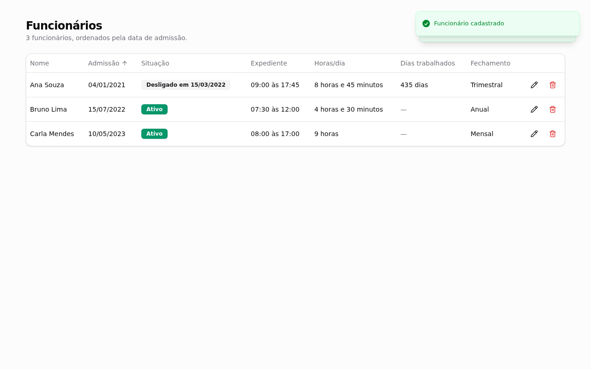
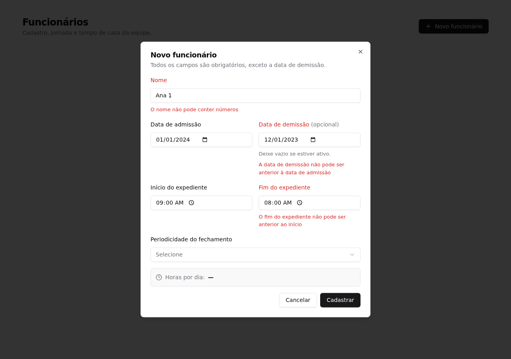
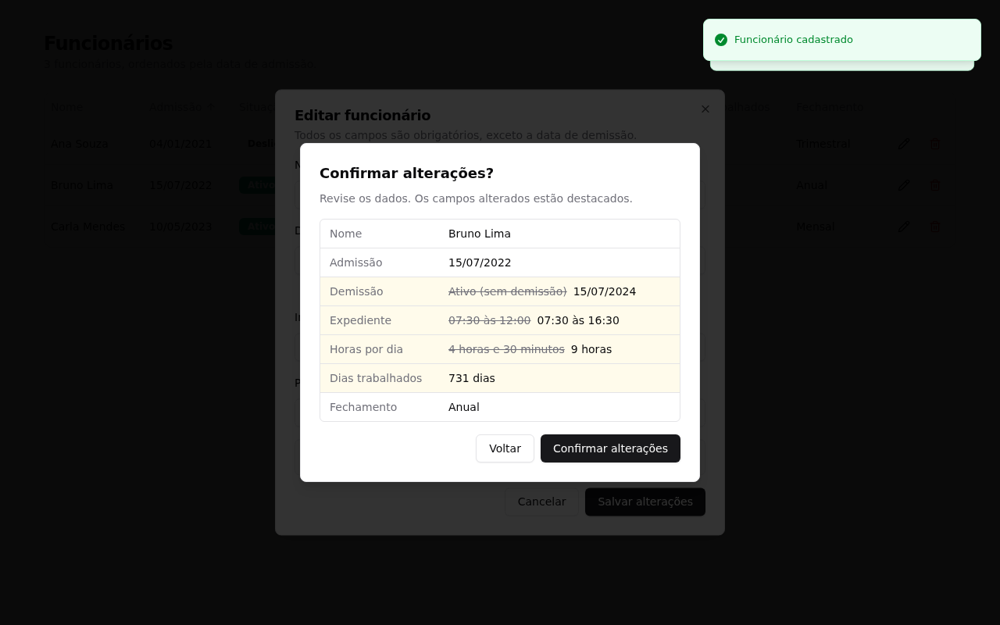
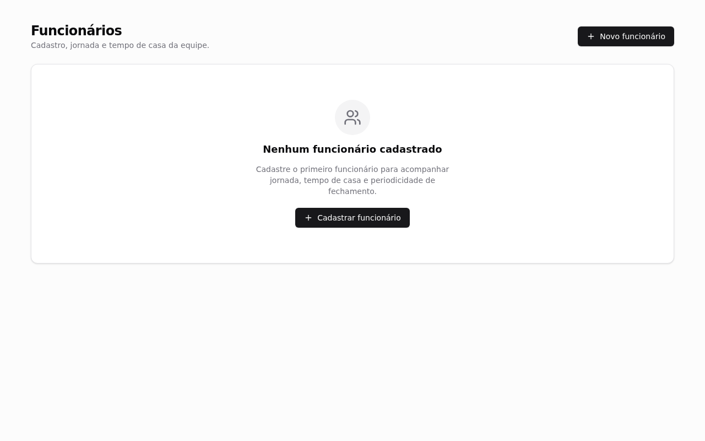

# CRUD de Funcionários

Cadastro, edição, listagem e exclusão de funcionários, com cálculo automático de dias trabalhados e horas diárias de expediente.

- **API:** NestJS 10 (sobre Express) + MongoDB/Mongoose em `apps/api`
- **Web:** Next.js 14 (App Router) + React + Tailwind CSS + shadcn/ui em `apps/web`

| Listagem | Validação inline |
|---|---|
|  |  |
| **Confirmação de edição** (campos alterados em destaque) | **Estado vazio** |
|  |  |

## Pré-requisitos

- Node.js 18.17+ (`.nvmrc` aponta para 18.20.8)
- Docker + Docker Compose (para o MongoDB)

## Instalação e execução

```bash
nvm use
npm install

cp .env.example .env                          # credenciais do MongoDB do docker compose
cp apps/api/.env.example apps/api/.env        # MONGODB_URI com as mesmas credenciais
cp apps/web/.env.example apps/web/.env.local  # URL da API usada pelo front

npm run db:up     # sobe o MongoDB
npm run dev:api   # http://localhost:3333
npm run dev:web   # http://localhost:3000
```

### Testes

```bash
npm test          # API (unitários + e2e) e Web
```

| Pacote | O que é testado | Como |
|---|---|---|
| API | Schema, DTOs, service e rotas HTTP (ordenação, validação, 400/404) | Jest + Supertest + `mongodb-memory-server` (não depende do docker) |
| Web | Cálculos de datas/horas (em vários fusos), schema Zod, formulário, tabela e estados da página | Jest + Testing Library |

## Variáveis de ambiente

Nenhuma credencial é versionada. Os arquivos `.env` estão no `.gitignore`, e os `.env.example` trazem apenas os nomes das variáveis.

| Arquivo | Variável | Descrição |
|---|---|---|
| `.env` | `MONGO_INITDB_ROOT_USERNAME` / `MONGO_INITDB_ROOT_PASSWORD` | Usuário e senha root criados pelo container do MongoDB |
| `.env` | `MONGO_PORT` | Porta exposta no host (padrão `27017`) |
| `apps/api/.env` | `MONGODB_URI` | Ex.: `mongodb://<usuario>:<senha>@localhost:27017/employees?authSource=admin` |
| `apps/api/.env` | `PORT` | Porta da API (padrão `3333`) |
| `apps/api/.env` | `WEB_ORIGIN` | Origem do front liberada no CORS (padrão `http://localhost:3000`) |
| `apps/web/.env.local` | `NEXT_PUBLIC_API_URL` | URL da API (padrão `http://localhost:3333`) |

## API

| Método | Rota | Sucesso | Erros |
|---|---|---|---|
| GET | `/employees` | 200, lista ordenada por data de admissão (mais antiga primeiro) | — |
| GET | `/employees/:id` | 200 | 404 |
| POST | `/employees` | 201 | 400 com `message: string[]` em português |
| PUT | `/employees/:id` | 200 (recebe o registro completo) | 400, 404 |
| DELETE | `/employees/:id` | 204 | 404 |

Exemplo de corpo:

```json
{
  "name": "Maria da Silva",
  "admissionDate": "2024-03-01",
  "dismissalDate": null,
  "workStartTime": "08:00",
  "workEndTime": "17:30",
  "closingPeriodicity": "Mensal"
}
```

## Estrutura

```
apps/
  api/src/modules/employees/
    schemas/       # schema Mongoose + regras entre campos (pre-validate)
    dto/           # CreateEmployeeDto / UpdateEmployeeDto (class-validator)
    validators/    # @IsNotBefore (demissão x admissão, fim x início)
    employees.service.ts / employees.controller.ts
  api/test/        # testes e2e das rotas
  web/src/
    lib/employees/ # cálculos (date-fns), schema Zod, tipos
    components/employees/  # formulário, modais, tabela, estado vazio
    components/ui/ # shadcn/ui
    hooks/         # TanStack Query
```

## 🛠️ Decisões Técnicas e Modernização da Stack

A especificação sugere Node.js + Express + MongoDB no backend e jQuery/Angular + Bootstrap + Moment.js no frontend. Mantive a base pedida (Node.js, Express como servidor HTTP e MongoDB) e troquei as camadas de frontend e utilitários por equivalentes atuais. Escolhi cada troca para facilitar a manutenção e os testes da solução. Nenhuma delas muda as regras de negócio.

### Resumo comparativo

| Camada | Tecnologia solicitada | Tecnologia adotada | Ganho técnico |
|---|---|---|---|
| Runtime / HTTP | Node.js + Express | Node.js + **NestJS** (Express por baixo) | Módulos com injeção de dependência, separação Controller/Service/DTO e testes isolados por camada |
| Banco de dados | MongoDB | MongoDB + **Mongoose** | Schema tipado com validações próprias, além das validações dos DTOs |
| Validação | — | **class-validator** (API) + **Zod** (web) | As mesmas regras são validadas no cliente e no servidor |
| Interface | jQuery ou Angular | **Next.js (App Router) + React** | UI declarativa em componentes reutilizáveis, sem manipulação imperativa do DOM |
| Estilo / componentes | Bootstrap | **Tailwind CSS + shadcn/ui (Radix UI)** | CSS gerado sob demanda e componentes acessíveis (WAI-ARIA, foco preso nos modais) |
| Datas | Moment.js | **date-fns** / funções nativas | Funções puras e imutáveis, importadas individualmente (tree-shaking) |

### 1. Aderência aos requisitos de negócio

Todos os requisitos da especificação estão implementados e cobertos por testes automatizados. Cada regra tem um ponto de implementação rastreável:

| Requisito | Onde é garantido |
|---|---|
| Nome obrigatório e sem números | `NAME_PATTERN` no schema Mongoose, `CreateEmployeeDto` e `employeeFormSchema` (Zod) |
| Data de demissão opcional e não anterior à admissão | Hook `pre('validate')` do schema, `@IsNotBefore` no DTO e regra cruzada no Zod |
| Expediente `HH:mm`; fim não anterior ao início | `TIME_PATTERN` + mesmas três camadas acima |
| Periodicidade restrita a Mensal/Bimestral/Trimestral/Semestral/Anual | Enum `ClosingPeriodicity` (schema e DTO) e `CLOSING_PERIODICITIES` (select do formulário e Zod) |
| Dias corridos entre admissão e demissão, exibidos só com demissão | `calculateWorkedDays` (web), no formulário (ao vivo), nos modais e na tabela |
| Horas por dia em texto legível ("8 horas e 30 minutos") | `calculateDailyWorkMinutes` + `formatDuration` (web) |
| Modal de confirmação ao criar, editar e excluir, com resumo dos dados | `ConfirmDialog` (AlertDialog do shadcn/ui) + `EmployeeSummary`. Na edição, os campos alterados aparecem em destaque |
| Listagem por admissão (mais antiga primeiro) e estado vazio | `EmployeesService.findAll` (`sort` por `admissionDate`), `EmployeesTable` e `EmployeesEmptyState` |

As regras ficam em três camadas (formulário, DTO e schema). Assim, uma chamada direta à API, sem passar pelo front, também não grava dados inválidos.

### 2. Backend: NestJS sobre Node.js, Express e MongoDB

O NestJS **usa o Express** (`@nestjs/platform-express`) como servidor HTTP, então a base pedida continua a mesma. Ele acrescenta:

- **TypeScript estrito** do schema ao controller;
- **Injeção de dependência e módulos**, que deixam o `EmployeesService` testável contra um MongoDB em memória, sem mocks frágeis;
- **Camadas separadas**: o controller cuida do HTTP, o service das regras e consultas, os DTOs com `class-validator` validam a entrada (o `ValidationPipe` global rejeita campos desconhecidos) e o schema Mongoose garante a integridade no banco.

### 3. Frontend: Next.js (React) em vez de jQuery / Angular legado

Com jQuery, a interface precisa sincronizar o estado com o DOM manualmente. Em React, a UI é declarada como função do estado. Isso vale especialmente para os **cálculos em tempo real** (dias trabalhados e horas/dia), que são atualizados enquanto o formulário é preenchido, via `useWatch`, sem nenhum código de sincronização. O Next.js com App Router organiza rotas e layouts e oferece um build de produção otimizado sem configuração extra. Os formulários usam `react-hook-form` + Zod, com mensagens de erro em cada campo, e os dados são buscados com TanStack Query, que atualiza a lista após cada operação.

### 4. Estilo e componentes: Tailwind CSS + shadcn/ui em vez de Bootstrap

O Tailwind gera **somente as classes usadas**, enquanto o Bootstrap traz uma folha de estilos completa. O shadcn/ui copia para o projeto componentes construídos sobre o **Radix UI**, que já cuidam da acessibilidade (atributos ARIA, navegação por teclado, foco preso e restaurado nos modais). Isso importa porque os modais de confirmação são centrais neste desafio. Os de confirmação usam `AlertDialog` (`role="alertdialog"`), que não fecha com clique fora nem durante a requisição. Como o código dos componentes fica no repositório, é possível ajustá-los sem sobrescrever o CSS de uma biblioteca externa.

### 5. Datas: date-fns / APIs nativas em vez de Moment.js

Desde 2020, o próprio time do Moment.js [recomenda não usá-lo em projetos novos](https://momentjs.com/docs/#/-project-status/) por causa do bundle grande, que não permite tree-shaking, e dos objetos mutáveis. O `date-fns` oferece funções puras sobre `Date`: cada operação devolve um valor novo, o que evita efeitos colaterais, e só as funções importadas entram no bundle. Para horários `HH:mm`, a conversão para minutos é aritmética simples e não precisa de biblioteca.

### Outras particularidades

- **Datas sem fuso:** admissão e demissão são datas de calendário. A API recebe `YYYY-MM-DD`, guarda à meia-noite UTC e devolve `YYYY-MM-DD`. O front interpreta como data local. Assim, o fuso do navegador nunca desloca o dia, e os testes de cálculo rodam em vários fusos.
- **Dias corridos:** calculados como a diferença entre as datas de calendário (admissão em 01/01 e demissão em 31/01 → 30 dias).
- **Limites inclusivos:** a especificação diz "não pode ser anterior". Então demissão no mesmo dia da admissão e fim de expediente igual ao início são aceitos.
- **Edição como PUT:** a edição envia o registro completo, para que as regras entre campos sempre tenham os dois valores.
- **Node 18:** as versões (NestJS 10, Next.js 14) foram escolhidas para rodar em Node 18 LTS. NestJS 11 e Next.js 15 exigem Node 20. O React 18 é fixado via `overrides` na raiz do monorepo.
